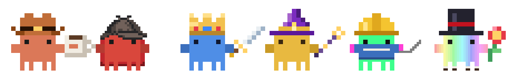
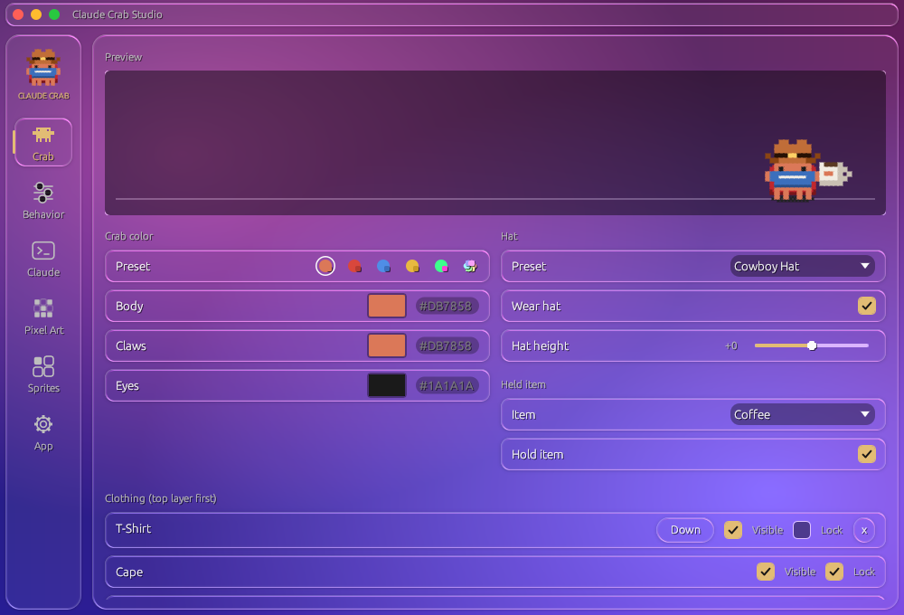
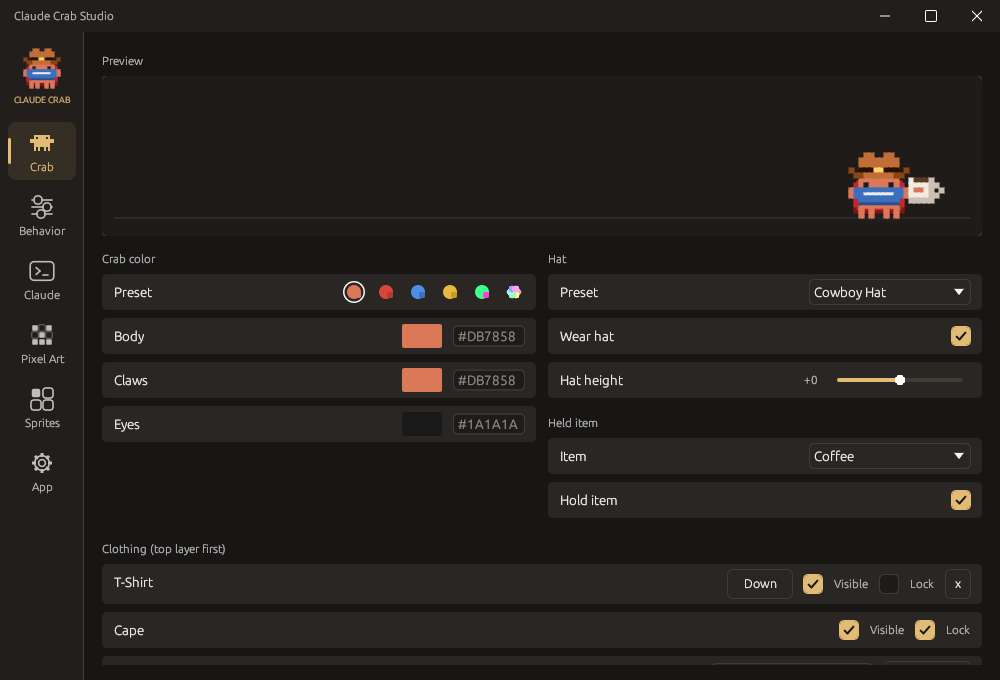
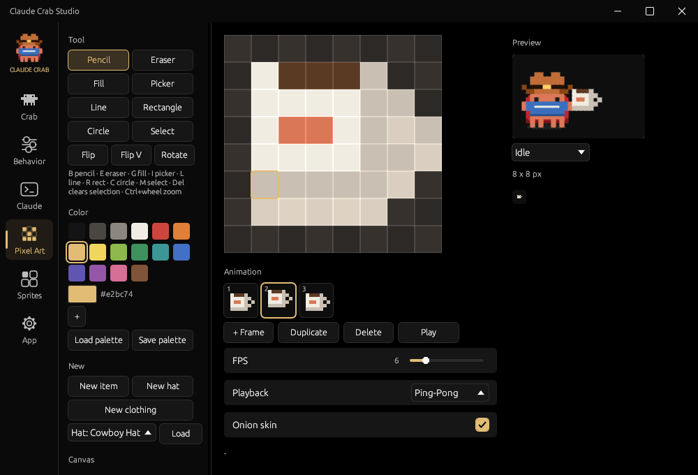
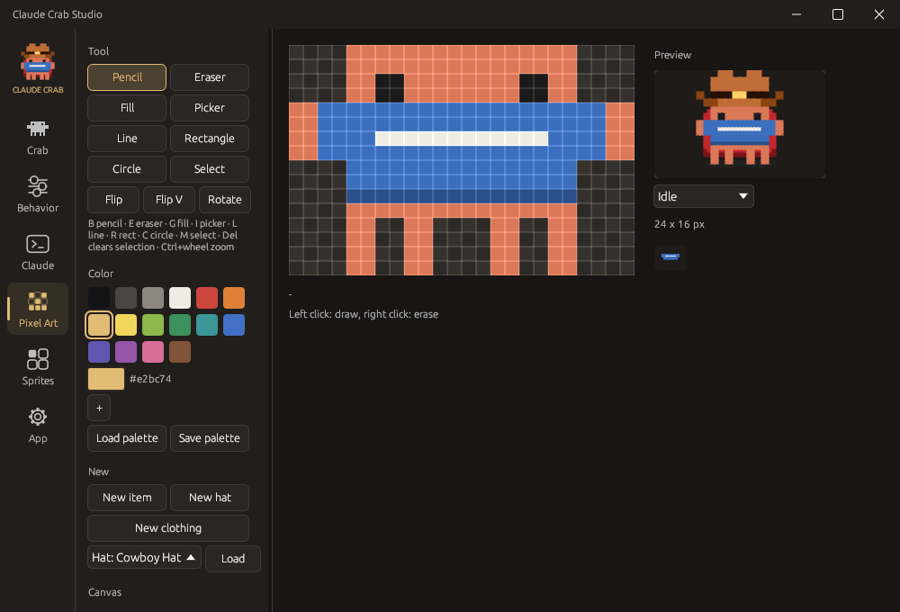

# Claude Crab

A pixel crab that lives on your Windows desktop, reacts to what Claude Code is doing, and comes with its own studio for designing hats, items, clothing and colours.

## Install

1. Download **ClaudeCrab-Setup.exe** from the [latest release](../../releases/latest)
2. Double-click it, pick a language (English / Deutsch), click **Install**
3. The crab appears in the bottom-right corner of your desktop

No admin rights needed. The setup installs per user to `%LOCALAPPDATA%\Programs\Claude Crab` (folder can be changed), adds a Start menu entry and optionally a desktop shortcut and autostart, and registers itself under Settings > Apps for uninstalling. To update, run the new setup: a running crab is closed for you, settings and sprites are kept.

> Windows SmartScreen may warn on first launch because the file is not signed: "More info" > "Run anyway".

For scripts: `ClaudeCrab-Setup.exe --silent [--dir=PATH] [--no-desktop] [--no-autostart] [--no-launch]`.

## What it does

- **Lives on your desktop.** Walks, breathes, looks around, falls asleep, stretches, and plays with whatever it holds: throws and catches it, drinks, sips coffee, smells the flower, casts spells, swings the sword or types on the laptop.
- **Follows Claude Code.** Connect it in the Studio and the crab shows what Claude is doing: thinking, editing code, running commands, asking a question, failing a tool, or celebrating when it is done. Only the kind of activity is sent, never prompts or file contents. Existing hooks in `~/.claude/settings.json` are kept, and a backup is written first.
- **Fully customisable.** Body, claw and eye colours (presets including Rainbow), hats, held items, clothing layers and saved outfits. The app, taskbar, tray and desktop icons follow your crab.
- **Three designs.** *Apple Lover* (live liquid glass that refracts what is behind the window), *Classic* and *Black*, each with a free accent colour.

## Studio

Right-click the crab or use the tray icon to open the Studio.

| Tab | Contents |
|---|---|
| **Crab** | Live preview, crab colours, hat, held item, clothing layers (order, visible, lock) and outfits |
| **Behavior** | Name, idle style, position, size, speed, window and mouse options, actions (sleep, pause, tricks, quit) |
| **Claude** | Connect to Claude Code, try every event, send a speech bubble |
| **Pixel Art** | Pixel editor for hats, items, clothing and buddies |
| **Sprites** | Library of presets and your own sprites |
| **App** | Language, design, accent colour, start with Windows, OBS visibility, debug console, save and reset |

### Pixel editor

Pencil, eraser, fill, picker, line, rectangle, circle and selection with move, plus flip, rotate, symmetry on both axes, zoom and 100 undo steps. Custom palettes can be saved and loaded as `palette.hex` in the export folder.

Held items can be **animated**: timeline with add, duplicate, delete and drag to reorder, onion skin, play/pause, 1–24 FPS, loop, ping-pong or once. Animated items play on the real crab and export as GIF and sprite sheet.

### Clothing

Clothing is painted straight onto the crab. Front pieces only show on the body and follow every pose; capes sit behind the crab and may stick out. Wear several pieces as layers and save combinations as outfits.

### Shortcuts

| Key | Action |
|---|---|
| B / E / G / I | Pencil / eraser / fill / picker |
| L / R / C / M | Line / rectangle / circle / select |
| Del / Esc | Clear selection / drop selection |
| Space | Play / pause animation |
| , / . | Previous / next frame |
| Ctrl+Z / Ctrl+Y | Undo / redo |
| Ctrl + mouse wheel, + / - | Zoom |

## Controls

| Action | Result |
|---|---|
| Left click | Pet the crab |
| Drag | Pick it up and drop it |
| Double-click | Say something or lasso |
| Right click | Open the Studio (or bring it to the front) |
| Tray icon, left | Open the Studio |
| Tray icon, right | Menu: talk, lasso, item trick, sleep, pause, hat, click-through, debug console, quit |

With click-through enabled the crab stays visible but the mouse goes to the window below. Hold Ctrl to interact with the crab anyway.

## Build (maintainer)

Double-click `build_installer.bat`. It installs missing tools via winget, builds the app, embeds it into the installer and writes `dist\ClaudeCrab-Setup.exe`. The installer source is in `installer\`.

App only: `cargo build --release`, output in `target\release\claude_crab.exe`. Tests: `cargo test --release`. Preview sheets of poses, items and Studio tabs are generated by the ignored tests, for example `cargo test --release studio_sheet -- --ignored`.

The crab runs in its own lightweight window without OpenGL, drawn into a pixel buffer with per-pixel transparency (`UpdateLayeredWindow`). The Studio (egui with its own software renderer) is a separate process (`claude_crab.exe --studio`) that only runs while its window is open.

## Troubleshooting

If the app crashes, the reason is written to `crab_error.log` next to the exe. The debug console (App tab, tray menu or `claude_crab.exe --debug`) shows a live log and writes `crab_debug.log`.

Settings and the sprite library are stored as `crab_config.json` and `crab_library.json` next to the exe. Exported PNGs and GIFs go to `Pictures\Claude Crab`. Only one crab runs at a time; starting it again opens the Studio of the running one.

## License

Free to install and use. The source code is published for reference only: it may not be modified, reused or redistributed. See [LICENSE](LICENSE).
